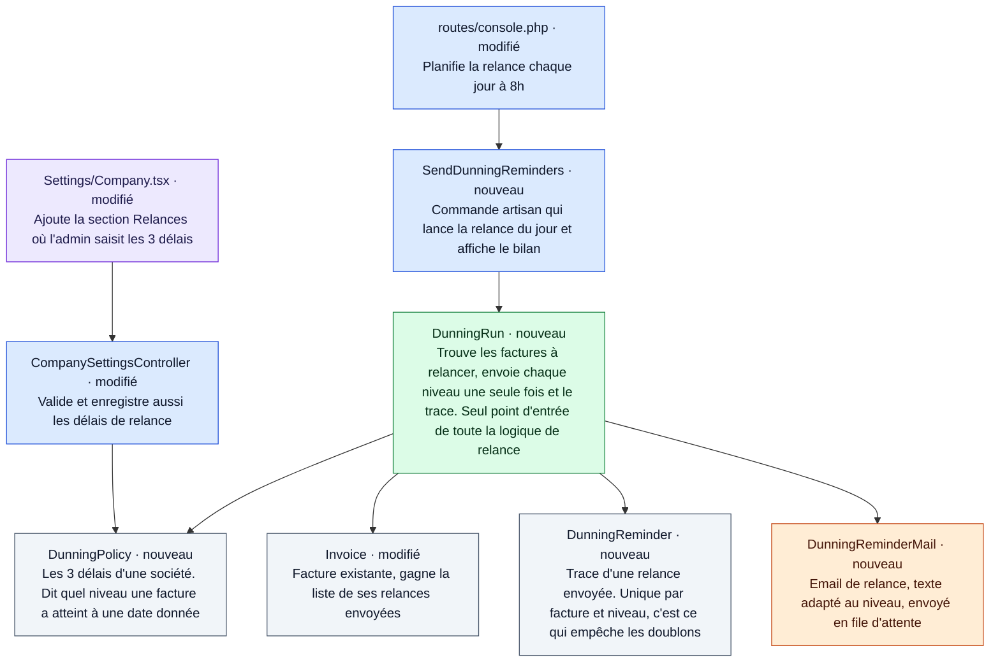

# ARCHITECTURE.md format

One file, two parts. Write it in the user's language; code identifiers stay as in code.

- **User part** (above the `---`): read by the user in 1 minute. Global picture only: no slices, no signatures.
- **Annex** (below the `---`): read only by `to-issues` and its writers. Complete enough that they never research the architecture or decide anything public.

## User part

1. `# <Feature name>`
2. `## <Summary>`: 2 or 3 lines in plain language: what the feature does, for whom, the key rule.
3. `## Architecture`: the Mermaid diagram, then the legend line.
4. `## <Technical decisions>`: only the gaps the grill left open. One bullet each: **chosen option** rather than rejected option: reason.

### Diagram rules

- `flowchart TD`, with exactly the 5 `classDef` lines of the example. No other style, no edge labels, only solid arrows `-->`.
- Arrow = "uses": parent calls child. Entry points at the top, deep modules in the middle, adapters and data at the leaves. A shared module appears once, with several parents.
- Node label: `Name · <status><br/>One sentence: what it does and where it is used.` Status is new, modified or existing, in the user's language. No HTML except `<br/>`, no double quotes inside a label.
- Show every new or modified module. Show an existing module only when it is the hook point of the feature.
- Types (one `classDef` each): `ui` (screens, components), `entree` (route, controller, command, job, listener), `deep` (business logic deep module), `adapter` (mail, external API, storage, queue), `donnee` (model, value object, DTO, enum).
- Legend line right under the diagram, translated to the user's language.

## Annex

Fixed English headings, so writers find their part:

- `## Annex: to-issues`
- `### Grill decisions`: every product and technical decision taken during the grill, one bullet each. `to-issues` may run in another session: this is its only source.
- `### Slices`: per slice: `S<n>: <title>`, Goal (one sentence), Done when (one pass/fail check), Blocked by, Creates / Modifies (module names), Reuses from upstream (exact symbols).
- `### Modules`: one entry per new or modified module: path, Interface (exact public signatures, invariants, ordering, error modes), Hides, Dependencies (category + how obtained), Called by (exact call site), Test surface, Mirror. For a modified module: exactly what changes.
- `### Shared facts`: conventions and rule files, `CONTEXT.md` terms used, test framework, test file location, exact command to run one test file.

## Example

````markdown
# Relance automatique des factures impayées

## En bref

Chaque matin à 8h, chaque facture impayée et échue reçoit au plus une relance par email par niveau (3 niveaux). L'admin règle les délais des 3 niveaux dans les paramètres de la société. Rejouer la relance du jour n'envoie jamais de doublon.

## Architecture



🟪 UI · 🟦 Point d'entrée (route, controller, commande) · 🟩 Deep module (logique métier) · 🟧 Adapter (mail, API externe, stockage) · ⬜ Donnée (model, value object)

## Décisions techniques

- **Un seul deep module `DunningRun`** plutôt qu'un `OverdueInvoiceFinder` + un `ReminderSender` : chacun n'aurait qu'un appelant (test de suppression), et un seul point de test couvre toute la relance.
- **Anti-doublon par contrainte unique `(invoice_id, level)`** plutôt qu'un champ `last_reminder_level` sur la facture : un rejeu ou deux exécutions simultanées ne peuvent pas envoyer deux fois.
- **`DunningPolicy` en value object casté sur `Company`** plutôt qu'une table dédiée : 3 entiers, toujours lus avec la société.
- **Mail en file d'attente** plutôt que synchrone : une panne SMTP ne bloque pas la commande. La trace est écrite avant l'envoi.

---

## Annex: to-issues

### Grill decisions

- 3 niveaux de relance, délais par défaut 7, 15 et 30 jours après échéance.
- Seules les factures au statut `sent` et échues sont relancées.
- Pas de relance manuelle dans cette feature.

### Slices

**S1: Délais de relance configurables par société**
- Goal: l'admin enregistre les 3 délais de relance de sa société.
- Done when: `php artisan test --filter=CompanyDunningSettingsTest` passe et la section Relances sauvegarde les délais.
- Blocked by: aucun.
- Creates: `DunningPolicy`. Modifies: `Company`, `CompanySettingsController`, `Settings/Company.tsx`.
- Reuses from upstream: aucun.

**S2: Envoi idempotent des relances du jour**
- Goal: `DunningRun::run()` envoie chaque niveau de relance une seule fois par facture.
- Done when: `php artisan test --filter=DunningRunTest` passe.
- Blocked by: S1.
- Creates: `DunningRun`, `DunningReport`, `DunningReminder`, `DunningReminderMail`. Modifies: `Invoice`.
- Reuses from upstream: `DunningPolicy::levelReachedOn(CarbonImmutable $dueDate, CarbonImmutable $today): ?int`, `Company::$dunning_policy`.

(S3 omitted in this example.)

### Modules

**`DunningRun`** · `app/Dunning/DunningRun.php` · new
- Interface: `run(CarbonImmutable $today): DunningReport`. Idempotent for a given `$today`. Never throws for a single invoice: the failure is counted in `skipped` and logged with `Log::warning`.
- Hides: the query of unpaid overdue invoices, the level via `DunningPolicy::levelReachedOn()`, the `DunningReminder` insert (a unique constraint violation means "already sent": skip), queuing the mail.
- Dependencies: `Invoice`, `DunningReminder` (Eloquent, local-substitutable: test database), `Mail` facade (`Mail::fake()` in tests). No custom injection.
- Called by: `SendDunningReminders::handle()`.
- Test surface: `run()` only, with `Mail::fake()` and the `Invoice` factory.
- Mirror: `app/Billing/InvoiceNumbering.php` (business service without an interface).

**`Invoice`** · `app/Models/Invoice.php` · modified
- Adds `dunningReminders(): HasMany` to `DunningReminder`. Nothing else changes.

(Other modules omitted in this example.)

### Shared facts

- Rules: `CLAUDE.md`, Pint (`vendor/bin/pint --dirty`).
- `CONTEXT.md` terms: Facture = `Invoice`, Société = `Company`, Relance = `DunningReminder`.
- Tests: Pest, `tests/Feature/<Domain>/<Name>Test.php`, run one file with `php artisan test --filter=<Name>`.
````
